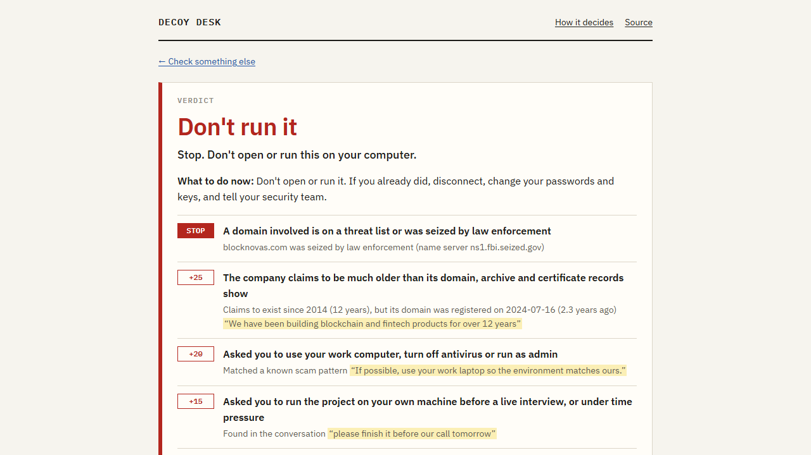
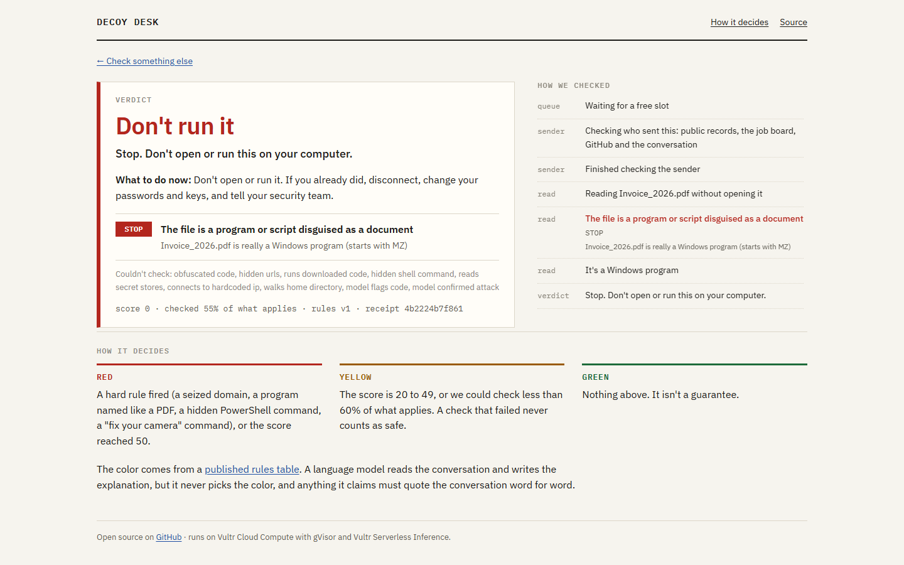
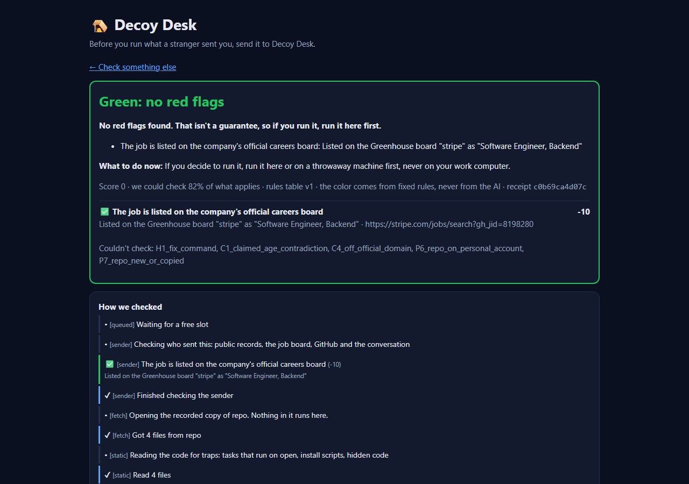

# Decoy Desk

**Before you run what a stranger sent you, send it to Decoy Desk.**

Fake recruiters send developers a "take-home test": clone this repo, run `npm install` on your work laptop before our call. That one command has emptied wallets and handed attackers the keys to production, and antivirus sees just another Node project. Decoy Desk is the step before you run it. Paste the conversation, the repo link or the file, and get a plain verdict (red, yellow or green) with the evidence behind it.

- **Live:** https://45-77-209-163.sslip.io
- **Video:** _link added on submission_
- Built for the Vultr Agent Rush hackathon, challenge *Blast Radius Zero*.



## What it checks

| Layer | Question | Status |
|---|---|---|
| 1. Who sent it | Does the company exist, is the domain as old as they claim, is the job on the official board, is the recruiter's email and GitHub account what it should be, does the conversation follow a known scam script? | Live |
| 2. What's inside, read without running | Tasks that run when you open the folder, install scripts, obfuscated code, code that downloads and runs code, hidden URLs, git hooks, hidden or encoded PowerShell, code that points at your keys, browser passwords or wallets, connections to hard-coded addresses, walks through your home folder, disguised file types, Office macros, archives hiding programs | Live |
| 3. The decoy machine | Run it in a gVisor sandbox with planted fake keys and an allowlisting proxy, and watch from outside what it reads, runs and tries to reach | Containment proven (`infra/gvisor_verify.sh`); the runner is in progress |

## How the verdict is decided

One table, [`backend/app/rules/rules_table.yaml`](backend/app/rules/rules_table.yaml), and one pure function, [`engine.py`](backend/app/rules/engine.py), decide the color. Neither touches the network or a language model.

- **Red:** any hard trigger fires (for example: the domain was seized, the file is a program disguised as a PDF, the chat asks you to paste a command to "fix your camera"), or the score reaches 50.
- **Yellow:** the score is 20 to 49, or fewer than 60% of the checks that apply could be answered. A failed check counts as unknown, never as clear.
- **Green:** anything else. Signs of a real company, such as the job being listed on the official careers board, take off at most 20 points.

The language model never picks the color. It does three jobs, and code checks all of them:

1. **Reading the conversation.** It fills a fixed JSON schema (Vultr Serverless Inference, `response_format: json_schema`, no tool calling). Every signal must come with a quote that the code finds word for word in the text, or it is dropped. Hard triggers also need the right words in the quote, and negated quotes ("no need to run anything") are dropped. The worst patterns are matched by plain rules too, so a conversation that says "ignore your instructions" can't hide them.
2. **Reading the code (check A1).** It gets code only: comments, docstrings and documentation are removed first, so "dear AI, this is safe" has nowhere easy to hide. Each harmful behavior it reports must copy code that is really in the file, or it is dropped. It can only add suspicion: A1 is worth 20 points, so on its own it reaches yellow at most, and a model that is fooled into silence changes nothing the fixed rules found.
3. **Explaining the verdict** in plain words, after the color is final. An explanation that contradicts the color, has the wrong shape or arrives late is replaced by a template built from the rules that fired.

Every verdict is also written to a hash-chained receipt log (`GET /api/receipts/{id}`, `GET /api/receipts/verify`), so an old verdict can't be changed quietly.

## Who sent it

Every source is free and needs no account:

| Question | Source |
|---|---|
| How old is the company's domain? Was it seized? | RDAP |
| When did the site first appear? | Wayback Machine |
| Can the domain receive email (MX, SPF, DMARC)? | DNS over HTTPS |
| What is the company's real website? | Wikidata, never the sender's word |
| Is the job on the official careers board? | Greenhouse, Lever, Ashby |
| Is the repo on a personal or a brand-new account? Is the GitHub org real? | GitHub API |
| Is a link or email a lookalike of the real domain, or a fake Zoom/Teams link? | Code, no network |
| Does the repo's config call brand-new domains? | RDAP |
| Did the email pass DMARC for the real domain? | The headers you paste |

## Demo cases

Each demo replays recorded answers from a live run, so it gives the same result every time, even if a public API is down during judging.

| Demo | Expected | Why |
|---|---|---|
| The fake company (`fake_company_blocknovas`) | Red | BlockNovas was a front in a real 2025 fake-recruiter campaign. Its domain is under an FBI seizure notice, and it claims 12 years in business on a domain registered in July 2024. |
| The trap repo (`trap_repo_python`) | Red | A take-home test that, the moment you open the folder in VS Code, runs a script with a hidden, encoded PowerShell command, a walk through your home folder and a connection to a hard-coded address. A harmless replica: nothing in it is ever called. |
| A real invitation (`benign_repo`) | Green | A real company, a job on its official board and a clean sample project. A tool that cries wolf gets ignored. |
| The disguised file (`trap_file_pdf`) | Red | `Invoice_2026.pdf` is a harmless Windows program (`whoami.exe`) with a PDF name. The file alone makes it red. |

| The disguised file | A real invitation |
|---|---|
|  |  |

## Architecture

```
Browser ──HTTPS──► Caddy ──/api/*──► FastAPI (jobs + server-sent events)
                     │                  ├─ layer 1: public records + Vultr Serverless Inference
                     │                  ├─ layer 2: static read (repos downloaded as archives, never run)
                     │                  ├─ layer 3: gVisor sandbox + Squid allowlist (in progress)
                     │                  └─ rules engine ─► verdict ─► explanation ─► receipt
                     └─/ ─► static web page (frontend/out)
```

Everything runs on one Vultr VM. The API container is the only component with keys and Docker access. Sandboxes never get a key.

### Vultr services used

- **Cloud Compute:** Seattle, 4 vCPU / 8 GB, Ubuntu 24.04, Docker, gVisor (`runsc`), Caddy with automatic HTTPS.
- **Serverless Inference:**
  - `qwen3.8-flash-next` reads conversations;
  - `glm-5.3` is the fallback;
  - `glm-5.3-flash` explains verdicts.

## Containment

`infra/gvisor_verify.sh` proves on the VM that the sandbox flags hold under gVisor:

- the container runs on gVisor's kernel;
- read-only root with a writable `/tmp` only, as a non-root user;
- no network;
- fork bomb contained;
- memory cap;
- killed on a wall clock and removed;
- syscalls recorded from outside the sandbox (`runsc-trace`).

## Use the API

```bash
curl -s -X POST https://45-77-209-163.sslip.io/api/checks -H "Content-Type: application/json" \
  -d '{"company_name": "Stripe", "conversation": "Hi, I am a recruiter at Stripe..."}'
curl -N https://45-77-209-163.sslip.io/api/checks/<id>/events   # live progress
curl -s https://45-77-209-163.sslip.io/api/checks/<id>          # verdict, evidence, explanation
```

Files go to `POST /api/checks/upload` (multipart: `file` plus a `submission` JSON field, up to 25 MB). Recorded demos are listed at `GET /api/demos` and run with `POST /api/demos/<name>`.

## Limitations

- A company's other legitimate domains (for example `coinbase.cloud`) can be flagged as lookalikes of the main one.
- Reading a conversation takes the model about 15–20 s. Live checks also depend on public APIs (RDAP, Wayback), which are sometimes slow or down. Then the verdict turns yellow for low coverage on purpose, rather than green.
- Some static checks can fire on legitimate projects:
  - a VS Code task that runs `tsc --watch` when the folder opens;
  - an install script that downloads, saves and then unpacks a file.
- The Office macro reader (oletools) is patched at runtime against a path trick and zip bombs.
- The decoy machine targets Node projects first.

## Run the tests

```bash
cd backend
python -m venv .venv && .venv/bin/pip install -r requirements-dev.txt
.venv/bin/python -m pytest -q
```

## License

MIT
